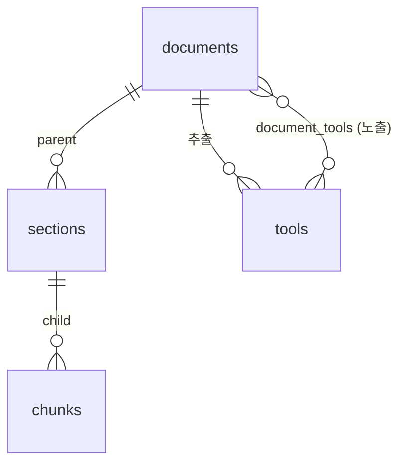
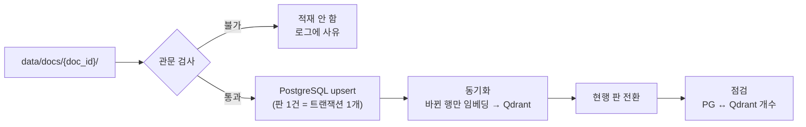

# 전처리 결과 DB 적재 방안 (PostgreSQL + Qdrant)

본 문서는 `kicox_preprocess_poc`가 만드는 전처리 결과(`data/docs/{doc_id}/*.json`)를 **PostgreSQL**과 **Qdrant**에 어떻게 넣을지 정리한 계획입니다. 임베딩 · BM25 · 컬렉션 운영은 원 프로젝트(국회대응) 정책을 따르고, 청킹 단위와 payload는 이 PoC의 3계층 구조에 맞게 새로 정합니다.

- **기준일**: 2026-10-28
- **상태**: §10 1~5단계 구현 (`ingest/`, `db/migrations/`). 로컬 2건으로 검증 (§10.1)
- **입력**: `kicox_preprocess_poc` 커밋 `c97fd03`의 산출물 형식. 로컬에 끝까지 처리된 문서 2건(`46e9cf81e6af` 맞춤형복리후생제도 운영지침, `e1f17de5627c` 보수규정 시행세칙)을 직접 확인했고, ALIO 138건은 서버(192.168.0.48)에서 처리 중입니다
- **관련 문서**: [RAG_DESIGN_NOTES.md](RAG_DESIGN_NOTES.md) §5.2 · §5.3 (저장소 역할 · 3계층), [ASSEMBLY_RAG_REFERENCE.md](ASSEMBLY_RAG_REFERENCE.md) §2 · §7 (원 프로젝트 정책), [RAG_FLOW_OVERVIEW.md](RAG_FLOW_OVERVIEW.md) §6, [MCP_TOOL_DESIGN.md](MCP_TOOL_DESIGN.md)

---

## 1. 요약

| 항목 | 결정(안) | 근거 |
| :--- | :--- | :--- |
| 저장 범위 | PostgreSQL에는 **질의 처리와 재색인에 쓰는 것만** 넣는다. 쪽 대조 · 구조 트리 · 검사 결과 · 검증 기록은 전처리 산출물 파일이 원본으로 남는다 | 검증 · 디버깅은 전처리 뷰어가 맡음 (§3) |
| 역할 분담 | PostgreSQL은 서비스 데이터의 원본, Qdrant는 PostgreSQL에서 다시 만들 수 있는 인덱스 | 설계 노트 §5.2 |
| 로더 위치 | `kicox_poc`에 `ingest/` 모듈. 전처리 저장소는 DB를 모르고 **파일(JSON)만 계약**으로 넘긴다. 계약 형식은 `meta.json`의 `schema_version`으로 관리 | 색인 · 질의가 같은 `embed()` · `sparse()`를 써야 함. 설계 노트 §5.5, §2.3 |
| 테이블 | `documents` · `sections` · `chunks` · `tools` · `document_tools` 5개 | §4 |
| 판 관리 | 개정판마다 `doc_id`(PDF 해시)가 바뀌므로 `documents.regulation_key`(ALIO `idx`)로 묶고, 규정마다 현행 판 하나만 검색 | §2.2 |
| 청크 ID | `uuid5(doc_id : 종류 : 내용 해시)` | 재청킹해도 내용이 같은 청크는 ID · 벡터 유지 (§5) |
| Qdrant 컬렉션 | 별칭 `reg_catalog`(문서 선택용) · `reg_chunks`(청크 검색용), 물리 이름 `{별칭}__bge-m3-ko__1024` | 설계 노트 §5.2 + 원 프로젝트 §2.4 |
| 벡터 | named vector `dense`(1024, COSINE) + `bm25`(sparse, `modifier=IDF`) | 원 프로젝트 §2.4 |
| 임베딩 · sparse | `bge-m3-ko`, 원 프로젝트 BM25(낱말 + 2-gram, CRC32). `avgdl`만 컬렉션별 실측값 | 원 프로젝트 §2.2 · §2.3 · §7.2. 2-gram 확정, Kiwi는 평가에서 비교 (§11-1) |
| child 입력 | dense는 `계층정보 + child 원문`, sparse는 **child 원문만** | 요구사항. 선택 문서 안 검색이라 계층 낱말은 BM25 구분력이 없음 (§6.2) |
| payload | 필터 · 묶기용 ID · 플래그 + child 포인트에 `text`(원문) · `dense_text`(dense 입력). 답변 근거는 계속 PostgreSQL에서 재확인 후 읽는다 | 요구사항. 청크 ID가 내용 해시라 payload 원문이 어긋나지 않음 (§6.3) |
| 동기화 | 원본 행의 `indexed_hash`와 현재 임베딩 입력 해시가 다른 행만 다시 임베딩 | 별도 장부 테이블 없이 (§6.5) |
| 품질 관문 | 산출물이 불완전한 판은 **적재하지 않는다**. 이전 판이 있으면 그대로 현행 유지 | §7.1 |
| 도구 | **승인된 도구만** 적재 | 승인 판정은 전처리 뷰어(`verify.json`)에서 함 |

---

## 2. 입력: 전처리 산출물

### 2.1 파일별 적재 여부

`data/docs/{doc_id}/` 아래 파일입니다.

| 파일 | 내용 | 적재 |
| :--- | :--- | :--- |
| `meta.json` | `schema_version`(산출물 형식 버전, §2.3) · `doc_id` · `name` · `pages` · `rule`(ALIO `idx` · 구분 · 제개정일) | `documents` (`schema_version`은 관문 판정에만 씀) |
| `chunks.json` | `parents`(p01…) · `children`(c001…) | `sections`, `chunks` |
| `summaries.json` | parent 요약(`covers` · `not_covers` · `keywords` · `questions`) · 문서 요약(`summary` · `keywords` · `questions` · `not_for`) | `sections`, `documents` |
| `tools.json` | 문서 단위 도구 목록(`spec` · `spec_hash` · `checks.status`) | 승인된 것만 `tools` |
| `verify.json` | 사람 검증 표시 (`{child hash}` · `parent:{hash}` · `tool:{spec_hash}`) | 저장하지 않고 `chunks.verified`와 도구 승인 판정에만 씀 |
| `parse.json` | VLM 결과 요약 (`truncated` 등) | 저장하지 않고 관문 판정에만 씀 |
| `source.pdf`, `pages/{n}.png` | 원본 PDF · 쪽 이미지 | 파일 저장소 `storage/docs/{doc_id}/`에 복사. 경로가 규칙으로 정해져 있어 DB에 적지 않음 |
| `compare.json`, `structure.json`, `render.json`, `parse_pages.json`, `chunking_config.json`, `pages/*.md`, `pages/*.text.txt`, `pipeline_logs/` | 쪽 대조 · 구조 트리 · 설정 · 로그 | 적재하지 않음 (전처리 뷰어 · 디버깅용) |

### 2.2 산출물에서 확인한 성질

| 성질 | 내용 | 적재에 주는 영향 |
| :--- | :--- | :--- |
| `doc_id` = PDF SHA-256 앞 12자 | 같은 규정이라도 개정판 PDF는 다른 `doc_id` | `regulation_key`로 판을 묶는다 |
| `rule` 없는 문서 | `data/inbox` · 웹 업로드 문서(예: 여비업무 처리기준)는 ALIO 정보가 없음 | `regulation_key` = `alio:{idx}`, 없으면 `manual:{doc_id}` |
| `c001` · `p01`은 문서 안 순번 | 재청킹하면 번호가 밀림 | PK로 쓰지 않는다. 순서는 `ordinal` |
| 청크 `hash` | child는 `header + "\n" + text`, parent는 child 본문을 이은 텍스트의 SHA-256 앞 16자 | 청크 ID와 검증 표시 조회의 기준 |
| stale | 요약 · 도구의 `parent_hash`가 현재 parent `hash`와 다르면 stale | 관문에서 걸러 stale 요약은 적재하지 않고, stale 도구는 승인 대상에서 뺌 |
| `searchable=false` | 목차 쪽 child | PostgreSQL에는 넣고 Qdrant에는 넣지 않음 |
| `neighbors` | 앞뒤 searchable child ID | 저장하지 않고 `ordinal`로 조회 |
| 문맥 머리말 | `header` = `문서명 > 장 > 조`. 표지 child는 `보수규정 시행세칙 > 보수규정 시행세칙`처럼 같은 항목이 반복되고, 작은 child를 합친 경우 첫 절만 나옴(예: c041) | 로더가 연속 중복을 줄여 dense 입력 · `dense_text`의 계층정보로 쓴다 (§6.2). 합친 child의 머리말 규칙은 전처리 과제 |

로컬 2건의 규모입니다. 138건 결과를 받으면(TODO.md 2단계) 다시 셉니다.

| 문서 | 쪽 | child | parent | 수치 child | 본문 토큰 | 도구 (상태) |
| :--- | :---: | :---: | :---: | :---: | :---: | :--- |
| 맞춤형복리후생제도 운영지침 | 5 | 25 | 8 | 10 | 3,033 | 0 |
| 보수규정 시행세칙 | 23 | 98 | 8 | 52 | 12,270 | 6 (error 3 · warn 1 · ready 2) |

### 2.3 산출물 형식 버전 (계약)

전처리와 적재는 저장소가 나뉘어 있고([RAG_DESIGN_NOTES.md](RAG_DESIGN_NOTES.md) §5.5) 둘 사이의 계약은 §2.1의 파일 형식 하나입니다. 형식이 바뀐 것을 로더가 알 수 있도록 `meta.json`에 정수 `schema_version`을 둡니다.

| 항목 | 규칙 |
| :--- | :--- |
| 위치 · 값 | `meta.json`의 `schema_version` (정수). 문서 판 하나의 모든 산출물 파일에 적용 |
| 올리는 경우 | 로더가 읽는 필드의 이름 변경 · 삭제 · 의미 변경(예: 청크 `hash` 계산식, `header` 형식, `verify.json` 키 규칙) |
| 올리지 않는 경우 | 필드 추가, 로더가 읽지 않는 파일(§2.1 "적재하지 않음") 변경 |
| 버전 1 | 커밋 `c97fd03` 형식. **`schema_version`이 없는 산출물은 1로 봅니다** (로컬 2건 · ALIO 138건이 여기에 해당) |
| 로더 | 지원하는 버전 목록을 두고, 목록에 없는 버전은 관문에서 적재하지 않습니다(§7.1). 버전마다 pydantic 모델을 둡니다 |
| 함께 바꾸기 | 전처리에서 버전을 올리는 커밋과 로더가 새 버전을 지원하는 커밋을 짝지어, 각 저장소의 변경 이력에 상대 커밋을 적습니다 |

- 전처리 과제: `meta.json`에 `schema_version: 1`을 쓰기 시작합니다. 이미 만든 산출물은 다시 돌리지 않아도 됩니다(없으면 1).
- 도구 승인 상태(`verify.json`)도 계약에 포함됩니다. 승인 판정은 전처리 뷰어에서 하고 로더는 읽기만 합니다.

---

## 3. 적재 원칙

1. **PostgreSQL에는 질의 처리와 재색인에 쓰는 것만 넣습니다.** 열마다 router · planner · agent · MCP 도구 · 재색인 중 어디서 읽는지가 있어야 합니다(§4.2). 쪽 대조, 구조 트리, 도구 검사 결과, 검증 이력은 전처리 산출물 파일이 원본이고 전처리 뷰어에서 봅니다.
2. **Qdrant는 PostgreSQL만으로 다시 만들 수 있어야 합니다.** 임베딩 모델을 바꿀 때 전처리 산출물을 다시 읽지 않습니다. 사람은 Qdrant를 직접 고치지 않습니다.
3. **전처리와 적재는 파일로만 이어집니다.** 로더는 `data/docs/{doc_id}/`를 읽기만 하고 전처리 코드를 import하지 않습니다. 파일 형식은 `schema_version`(§2.3)과 로더 쪽 pydantic 모델로 검증하고, 형식이 바뀌면 명시적으로 실패합니다.
4. **문서 판 1건이 적재 단위입니다.** 한 판의 행은 트랜잭션 하나로 넣고, 같은 입력으로 다시 실행해도 결과가 같아야 합니다(멱등).
5. **원 프로젝트를 따르는 것과 새로 정하는 것을 나눕니다.** 임베딩 호출 · BM25 생성 · 컬렉션 별칭 · 재색인 절차는 [ASSEMBLY_RAG_REFERENCE.md](ASSEMBLY_RAG_REFERENCE.md) §7.1을 따르고, 포인트 종류 · 임베딩 입력 · payload · 청크 ID는 새로 정합니다.
6. **검색 결과는 PostgreSQL로 다시 거릅니다.** 필터 없는 검색을 막고, Qdrant 결과는 PostgreSQL에서 현행 판인지 확인한 뒤 씁니다.

---

## 4. PostgreSQL 스키마

### 4.1 관계



### 4.2 테이블

**`documents`** — 문서 판 (PDF 하나)

| 열 | 형식 | 쓰는 곳 |
| :--- | :--- | :--- |
| `id` | `text` PK | `doc_id` |
| `regulation_key` | `text` | 현행 판 판정. `alio:{idx}` 또는 `manual:{doc_id}` |
| `name` | `text` | router 후보 표시, 근거 표시, 임베딩 입력 |
| `amended_on` | `date` null | 현행 판 판정 (ALIO 제개정일) |
| `status` | `text` | `LOADED` · `INDEXED` · `SUPERSEDED` · `REPEALED` (§7.4) |
| `is_current` | `bool` | 검색 결과 재확인. `UNIQUE(regulation_key) WHERE is_current` |
| `summary`, `not_for` | `text` | router 후보 표시 (`summary`는 임베딩 입력도) |
| `keywords`, `questions` | `text[]` | catalog 재색인 |
| `content_hash` | `text` | 적재한 산출물(`chunks` · `summaries` · `tools` · `verify`)의 묶음 해시. 같으면 적재를 건너뜀 |
| `indexed_hash` | `text` null | catalog 포인트(요약 + 예상 질문)를 마지막으로 색인한 입력의 해시 |

**`sections`** — parent

| 열 | 형식 | 쓰는 곳 |
| :--- | :--- | :--- |
| `id` | `uuid` PK | §5 |
| `document_id` | FK | 선택 문서의 parent 목록 |
| `ordinal` | `int` | planner 표시 순서 |
| `title` | `text` | planner 표시, 임베딩 입력 |
| `page_start`, `page_end` | `int` | planner 표시, 근거 표시 |
| `covers`, `not_covers` | `text` | planner 표시 (`covers`는 임베딩 입력도) |
| `keywords`, `questions` | `text[]` | parent 요약 재색인 |
| `searchable` | `bool` | 목차만 있는 parent는 색인하지 않음 |
| `content_hash` | `text` | ID 생성 · 변경 판단 |
| `indexed_hash` | `text` null | parent 요약 포인트 동기화 |

**`chunks`** — child

| 열 | 형식 | 쓰는 곳 |
| :--- | :--- | :--- |
| `id` | `uuid` PK | §5 |
| `document_id`, `section_id` | FK | 문서 필터, parent 묶기 |
| `ordinal` | `int` | 앞뒤 이웃 조회 |
| `header`, `body` | `text` | agent 원문 조회, 리랭크 입력, 임베딩 입력. 원문과 머리말은 분리해 저장 (설계 노트 §5.3.2 규칙 3) |
| `tokens` | `int` | 컨텍스트 예산 계산 (seed32-think 토크나이저 기준) |
| `page_start`, `page_end` | `int` | 근거 표시 |
| `searchable` | `bool` | 색인 대상 여부 |
| `has_numbers`, `verified` | `bool` | 답변의 "검증 전 수치" 표시 (§8) |
| `content_hash` | `text` | ID 생성 |
| `indexed_hash` | `text` null | child 포인트 동기화 |

**`tools`** — 승인된 계산 도구 spec

| 열 | 형식 | 쓰는 곳 |
| :--- | :--- | :--- |
| `id` | `uuid` PK | `uuid5(doc_id : tool : spec_hash)` |
| `document_id` | FK | 추출한 문서 |
| `section_id` | FK | 근거 parent (도구 결과의 `basis`에 쪽 표시) |
| `name` | `text` | MCP 도구 이름, 문서 안 `lookup` 대상. `UNIQUE(document_id, name)` |
| `spec` | `jsonb` | MCP `list_tools` 노출과 `tools_exec.run(spec, args, tables)` 실행. 종류 · 설명 · 입력 · 단위가 모두 여기 있음 |

- **적재 조건**은 `preprocess.tools.approved`와 같습니다: `verify.json`에 `tool:{spec_hash}` 검증 표시가 있고 · stale이 아니며 · `checks.status`가 `error`가 아님. 로더는 전처리 코드를 부르지 않으므로 `tools.json`에 저장된 `checks.status`를 씁니다.
- `lookup`이 부르는 표 도구(`table_lookup`)도 같은 조건으로 들어옵니다. 승인되지 않은 표를 부르는 식 도구는 실행할 수 없으므로 함께 뺍니다.
- MCP에 노출할 때 도구 이름은 문서끼리 겹칠 수 있어 접두어를 붙입니다. 규칙은 MCP 서버 구현 때 정합니다.

**`document_tools`** — `(document_id, tool_id)` PK

- 적재할 때 추출한 문서와 잇습니다. 교육 문서 질문에 여비 도구가 필요한 경우처럼 다른 문서의 도구도 노출해야 할 때는 사람이 행을 더합니다(설계 노트 §3-4의 N:M). 사람이 더한 행은 로더가 지우지 않도록 `added_by` 열(`ingest` · `manual`)을 둡니다.

### 4.3 지금 만들지 않는 것

| 항목 | 이유 | 필요해지는 때 |
| :--- | :--- | :--- |
| 규정 테이블 | `regulation_key` 열로 현행 판을 정할 수 있음 | 소관 부서 등 규정 단위 속성이 생길 때 |
| 쪽 테이블 (마크다운 · 텍스트 레이어 · 유사도) | 쪽 대조와 검증은 전처리 뷰어가 함 | 검증 화면을 `kicox_poc`로 옮길 때 |
| 구조 트리 · 청킹 설정 · 모델 · 토큰 기록 | 디버깅 · 이력용이고 파일에 남아 있음 | — |
| 검증 테이블 | PoC 동안 원본은 `verify.json`. 적재 때 `chunks.verified`만 채움 | 검증 화면을 옮길 때. 그때 개정판으로 검증을 물려주는 규칙도 함께 정함 |
| 도구 검사 결과 · 상태, 미승인 도구 | 승인 판정을 전처리 뷰어에서 끝냄 | 위와 같음 |
| 카테고리 테이블 | 분류안이 없음 (설계 노트 §4.3) | 분류를 정할 때. payload `category_ids`도 그때 추가 |
| 색인 장부 · 컬렉션 기록 · 적재 실행 기록 | `indexed_hash` 열, 물리 컬렉션 이름, 로그 파일로 충분 | — |

---

## 5. ID 규칙

| 대상 | ID |
| :--- | :--- |
| 문서 판 | `doc_id` (전처리와 같은 값) |
| parent | `uuid5(NS, f"{doc_id}:parent:{hash}:{n}")` |
| child | `uuid5(NS, f"{doc_id}:child:{hash}:{n}")` |
| 도구 | `uuid5(NS, f"{doc_id}:tool:{spec_hash}")` |

- `n`은 같은 문서 안에서 같은 해시가 반복될 때만 1, 2 …로 늘립니다(보통 0). `NS`는 이 PoC 전용으로 한 번 정한 고정 UUID입니다.
- **원 프로젝트(`uuid5(doc_id_chunk_idx)`)와 다른 이유**: 이 PoC는 웹 뷰어에서 재청킹하는 일이 잦고, 그때 `c001` 순번이 밀립니다. 순번 ID면 내용이 같은 청크도 ID가 바뀌어 다시 임베딩하고 근거 링크가 끊깁니다. 내용 해시 ID면 **바뀐 청크만 새 ID**가 됩니다. 원 프로젝트가 "청킹 규칙 고정"으로 지키려던 것(근거 링크 유지)을 다른 방법으로 지킵니다.

---

## 6. Qdrant

### 6.1 컬렉션

| 항목 | `reg_catalog` | `reg_chunks` |
| :--- | :--- | :--- |
| 쓰는 곳 | router: 문서 후보 10~20개 | planner: 선택 문서(최대 3개) 안의 parent · child 후보 |
| 물리 이름 | `reg_catalog__bge-m3-ko__1024` | `reg_chunks__bge-m3-ko__1024` |
| 임베딩 없을 때 | `reg_catalog__bm25__0` | `reg_chunks__bm25__0` |
| 벡터 | `dense`(1024, COSINE) + `bm25`(sparse, IDF) | 같음 |

- 앱은 별칭으로만 읽고 씁니다. 기동 시 별칭 대상 컬렉션의 벡터 설정(모델 · 차원 · sparse)이 현재 설정과 다르면 오류로 멈춥니다(원 프로젝트 `CollectionMismatch`). 모델 · 차원은 물리 이름에 들어 있어 따로 기록하지 않습니다.
- 원 프로젝트처럼 컬렉션 하나에 다 넣지 않는 이유: 문서 선택과 청크 검색은 질의 시점 · 필터 · 묶는 기준(`doc_id` vs `section_id`)이 다르고, 문서 포인트가 청크보다 훨씬 적어 섞으면 문서 후보 검색이 청크에 묻힙니다.
- PoC는 Qdrant 1대로 시작합니다. 원 프로젝트의 2대 이중화는 운영 전환 때 들여옵니다.

### 6.2 포인트 종류와 임베딩 입력

| 컬렉션 | `kind` | 개수 | dense 입력 텍스트 | sparse(BM25) 입력 텍스트 | 포인트 ID |
| :--- | :--- | :--- | :--- | :--- | :--- |
| `reg_catalog` | `doc_summary` | 판당 1 | `{문서명}\n{summary}\n키워드: {keywords}` | dense와 같음 | `uuid5(f"{doc_id}:doc_summary")` |
| `reg_catalog` | `doc_question` | 판당 5~8 | `{question}` | dense와 같음 | `uuid5(f"{doc_id}:doc_question:{i}")` |
| `reg_chunks` | `parent_summary` | searchable parent당 1 | `[{문서명} > {title}]\n{covers}\n키워드: {keywords}\n예상 질문: {questions}` | dense와 같음 | `uuid5(f"{section_id}:summary")` |
| `reg_chunks` | `child` | searchable child당 1 | `[{header}]\n{body}` (계층정보 + child 원문) | `{body}` (child 원문만) | `chunks.id` |

- **넣지 않는 것**: `not_for` · `not_covers`(이웃 문서 단어로 엉뚱한 질의에 걸림, 설계 노트 §4.2), `searchable=false` child(목차), 현행이 아닌 판.
- 예상 질문을 따로 포인트로 두는 이유는 설계 노트 §5.2(질문형 질의가 예상 질문과 가장 잘 맞음). 검색 뒤 `doc_id`로 묶습니다.
- **child의 dense와 sparse 입력을 나누는 이유** (설계 노트 §5.3.2 규칙 3):
  - dense에는 계층정보(`header`, 연속 중복은 하나로)를 붙여 "② 단, 위의 경우는…" 같은 child도 문맥을 갖고 검색되게 합니다. 계층정보는 중앙값 24토큰, 최대 43토큰(로컬 2건)이라 입력 한도에 부담이 없습니다.
  - sparse는 원문만 넣습니다. planner 검색은 늘 `doc_id ∈ 선택 문서`로 걸러지므로 문서명 · 장 제목 낱말은 후보를 가르지 못하고, 같은 장 child가 모두 그 낱말을 가지면 IDF가 낮아지고 점수가 평평해집니다. child 약 81%(123개 중 100개)는 본문 첫 줄에 자기 조 제목이 이미 있어 잃는 것도 적습니다.
- **parent `covers` 첫 문장은 기본 입력에서 뺍니다.** 넣으면 parent 요약을 다시 만들 때 그 parent의 child도 다시 임베딩해야 합니다. dense 입력에 `covers` 첫 문장을 더한 변형을 평가 질의로 비교해 나을 때만 넣습니다(§11-8).
- `parent_summary` · catalog 포인트는 요약 자체가 짧은 용도 텍스트라 dense와 sparse 입력을 같게 둡니다.
- 입력 형식은 코드 상수 `EMBED_TEXT_VERSION`으로 관리하고, 바꾸면 전체 재색인합니다.

### 6.3 payload

원 프로젝트 payload를 따르지 않습니다. 필터와 묶기에 필요한 키와, 요구사항에 따라 child 원문을 둡니다.

| 키 | 형식 | catalog | chunks | 용도 |
| :--- | :--- | :---: | :---: | :--- |
| `kind` | keyword | O | O | 포인트 종류 |
| `doc_id` | keyword | O | O | 선택 문서 필터, 문서별 묶기, 삭제 단위 |
| `is_current` | bool | O | O | **필수 필터** |
| `section_id` | keyword | | O | parent 묶기 (planner 표시) |
| `verified` | bool | | O | 엄격 모드 평가용 (§8) |
| `text` | text (인덱스 없음) | | child | child 원문 (`chunks.body`). 미리보기 · 디버깅 |
| `dense_text` | text (인덱스 없음) | | child | dense에 실제로 넣은 문자열 (계층정보 + child 원문). 리랭크 입력, 임베딩 재현 · 디버깅 |

- 필터 인덱스: keyword `kind` · `doc_id` · `section_id`, bool `is_current` · `verified`.
- **원문을 두어도 어긋나지 않는 이유**: child ID가 `header + "\n" + text`의 해시라(§5), 본문이나 계층이 바뀌면 ID 자체가 바뀌어 새 포인트가 됩니다. 같은 ID의 payload 원문이 PostgreSQL과 달라질 일이 없습니다. 용량은 child 6천 개 기준 수십 MB입니다.
- "계층정보 + child 원문"은 `header`와 `text`를 이은 것이지만, dense 입력 형식(중복 제거, §11-8의 `covers` 변형)이 바뀌어도 실제 임베딩 입력을 그대로 보려고 `dense_text`로 저장합니다.
- **PostgreSQL 재확인은 그대로 합니다**(원칙 6). 현행 판 전환 사이에는 두 판 포인트가 잠깐 함께 있으므로, payload 원문은 리랭크 · 미리보기에만 쓰고 답변 근거(원문 · 쪽 · 검증 여부)는 재확인 SQL에서 읽습니다.
- 쪽번호 · 제목은 넣지 않습니다. 근거 표시에만 쓰여 재확인 SQL로 충분합니다.
- `is_current` · `verified`가 바뀌면 다시 임베딩하지 않고 `set_payload`로 고칩니다.

### 6.4 검색에서 쓰는 방식 (참고)

검색 API는 다음 문서에서 정하지만, 적재 구조가 아래 사용을 받쳐야 합니다.

```text
router  : reg_catalog  질의 분석이 다시 쓴 질의로 dense top 40 + bm25 top 40 (filter is_current)
          → 앱 RRF(k=60, 포인트 단위) → doc_id별 최고 점수로 묶기 → 문서 후보 10~20
          → PostgreSQL에서 documents(name, summary, not_for, is_current) 조회
planner : reg_chunks   dense + bm25 (filter is_current, doc_id ∈ 선택 문서)
          → 앱 RRF → PostgreSQL에서 chunks · sections 조회(재확인 + 본문) → 리랭크(child)
          → section_id로 묶어 "parent 요약(covers · not_covers) + 적중 child 표시"
agent   : get_chunks(ids) → PostgreSQL에서 child + ordinal 앞뒤 이웃
```

- RRF는 원 프로젝트처럼 앱 코드에서 합칩니다(Qdrant 내장 fusion을 쓰지 않음). 설계 노트 §5.2의 "Qdrant Query API RRF"는 이것으로 바꿉니다(§11-2).
- 후보 수 · 최종 수 · 출처 다양성 단위(문서 또는 parent)는 평가로 정합니다(원 프로젝트 §7.2).

### 6.5 동기화

별도 장부 없이 원본 행의 `indexed_hash`로 판단합니다.

1. 이번에 적재한 판마다 PostgreSQL에서 "있어야 할 포인트"와 각 포인트의 임베딩 입력(§6.2)을 만듭니다. 입력 해시는 dense 입력과 sparse 입력을 함께 넣어 계산합니다.
2. 입력 해시가 원본 행의 `indexed_hash`와 다른 포인트만 임베딩해 upsert하고, 성공하면 `indexed_hash`를 갱신합니다. 입력 해시에는 `EMBED_TEXT_VERSION` · 물리 컬렉션 이름 · `avgdl`도 넣어, 이것들이 바뀌면 다시 색인됩니다. catalog 포인트는 판 하나를 묶음으로 봅니다(`documents.indexed_hash`, 요약이 바뀌면 질문 포인트까지 함께 다시 임베딩. 판당 10개 안팎).
3. 해시가 같은 포인트는 payload 전체를 덮어씁니다(`verified` · `is_current`, 그리고 재청킹으로 parent ID가 바뀐 형제 child의 `section_id`. 컬렉션마다 `batch_update_points` 요청 하나).
4. Qdrant에서 그 `doc_id`의 포인트 ID를 훑어(`scroll`, ID만) 1의 목록에 없는 것을 지웁니다. 재청킹으로 사라진 청크가 여기서 정리됩니다.

중간에 실패하면 `indexed_hash`가 갱신되지 않은 행만 남으므로, 다시 실행하면 그 행부터 이어서 합니다.

---

## 7. 적재 절차



### 7.1 관문 검사

다음 중 하나라도 해당하면 그 판은 적재하지 않고 사유를 로그에 남깁니다. 같은 규정의 이전 판이 현행이면 그대로 둡니다.

| 사유 | 판정 |
| :--- | :--- |
| 필수 파일 없음 | `meta.json` · `chunks.json` · `summaries.json` |
| 지원하지 않는 형식 버전 | `meta.schema_version`(없으면 1)이 로더의 지원 목록에 없음 (§2.3) |
| 파일 형식 오류 | pydantic 검증 실패 |
| 문서 요약 없음 | `summaries.doc.error` 있음 또는 `summary` 비어 있음 |
| parent 요약 문제 | 빠진 parent, `error`, stale (`parent_hash` ≠ parent `hash`) |
| 잘린 쪽 | `parse.truncated` 있음 |

- 쪽 대조(`compare.flagged`)와 도구 오류는 적재를 막지 않습니다. 쪽 대조는 전처리 뷰어의 검증 대상이고, 도구는 승인된 것만 들어오기 때문입니다.
- `tools.json`이 없으면 도구 없이 적재합니다.
- 138건 일괄 적재 뒤 사유별 건수를 표로 정리해, 전처리 쪽에서 다시 돌릴 문서를 고릅니다.

### 7.2 PostgreSQL upsert

문서 판 하나를 트랜잭션 하나로 처리합니다.

1. `documents`를 `doc_id`로 upsert. 산출물 묶음 해시(`content_hash`)가 이전과 같으면 2~4를 건너뜁니다.
2. `sections` · `chunks`를 §5의 ID로 upsert하고, 이번 입력에 없는 행(재청킹으로 사라진 것)은 지웁니다. 내용이 같은 행은 ID가 같으므로 `indexed_hash`가 남습니다. `ordinal`은 매번 새 값으로 씁니다.
3. `chunks.verified`를 `verify.json`의 `{child hash}` 표시로 채웁니다.
4. 승인된 도구를 upsert하고 승인이 풀린 도구는 지웁니다. `document_tools`는 `added_by='ingest'` 행만 맞춥니다.
5. 새 판이면 `status=LOADED`, `is_current=false`로 둡니다. 이미 현행인 판을 다시 적재한 경우에는 상태를 그대로 둡니다.

### 7.3 동기화와 현행 판 전환

1. §6.5 방식으로 포인트를 맞춥니다. 새 판의 포인트는 `is_current=false`로 넣습니다.
2. 모두 성공하면 `INDEXED`. 실패하면 `LOADED`로 남고, 다음 실행에서 `indexed_hash`가 없는 행부터 이어서 합니다.
3. **현행 판 전환**: 같은 `regulation_key`의 `INDEXED` 판 중 `amended_on`이 가장 늦은 판을 현행으로 합니다(같으면 기존 현행 유지). 트랜잭션으로 이전 판을 `SUPERSEDED` · `is_current=false`, 새 판을 `is_current=true`로 바꾸고 이전 판 행의 `indexed_hash`를 비운 뒤, Qdrant에서 새 판 포인트를 `set_payload(is_current=true)`, 이전 판 포인트는 삭제합니다. `indexed_hash`를 비워 두므로 이전 판을 다시 살리면 전량 색인됩니다.
4. PostgreSQL 커밋과 Qdrant 갱신 사이에는 잠시 두 판이 모두 검색될 수 있지만, 검색 결과를 PostgreSQL에서 다시 거르므로 답변에 이전 판이 섞이지 않습니다.
5. 이전 판의 PostgreSQL 행은 지우지 않습니다(이전 답변의 근거 링크용).

### 7.4 문서 판 상태

| 상태 | 의미 | 검색 |
| :--- | :--- | :---: |
| `LOADED` | PostgreSQL에 들어감, 색인 전이거나 색인 실패 | X |
| `INDEXED` | 색인 완료 | `is_current`일 때 O |
| `SUPERSEDED` | 새 판으로 바뀜 | X |
| `REPEALED` | 규정 폐지 | X |

### 7.5 점검

적재 · 동기화가 끝날 때마다 판별로 확인하고 로그에 남깁니다.

- 산출물 개수 = PostgreSQL 행 수 (child · parent · 승인 도구)
- PostgreSQL에서 계산한 포인트 수 = Qdrant `count(filter doc_id)`
- `indexed_hash`가 비어 있는 searchable 행 0개
- `is_current` 판이 규정마다 하나

### 7.6 다시 실행하는 경우

| 상황 | 로더가 하는 일 | 다시 임베딩되는 범위 |
| :--- | :--- | :--- |
| 같은 산출물로 다시 실행 | 묶음 해시가 같아 건너뜀 | 없음 |
| 뷰어에서 재청킹 | 바뀐 child · parent만 새 ID, 사라진 것은 삭제 | 바뀐 child · parent 요약 |
| parent 요약만 다시 생성 | `sections` 요약 열 갱신 | 그 parent 요약 포인트 (child 입력에 `covers`를 넣기로 하면 그 parent의 child도, §11-8) |
| 문서 요약만 다시 생성 | `documents` 요약 열 갱신 | 그 판의 catalog 포인트 |
| 검증 · 승인 표시만 바뀜 | `chunks.verified` · `tools` 갱신 | 없음 (`set_payload`) |
| 규정 개정 (새 PDF) | 새 판 적재 → 색인 → 현행 전환 | 새 판 전체 |
| 규정 폐지 | 현행 판을 `REPEALED` · `is_current=false` | 포인트 삭제 |
| 임베딩 모델 교체 | 새 물리 컬렉션을 PostgreSQL에서 채움 → 평가 → 별칭 전환 (원 프로젝트 §2.5). 새 컬렉션용 `indexed_hash`는 쓰지 않고 전량 적재 | 전체 (재파싱 없음) |
| BM25 토큰 규칙 · `avgdl` · 입력 형식 변경 | 위와 같은 절차 | 전체 |

- 모델 교체처럼 컬렉션을 통째로 새로 만들 때는 `indexed_hash`와 상관없이 전량을 넣고, 별칭을 전환할 때 `indexed_hash`를 새 컬렉션 기준으로 다시 씁니다. 두 컬렉션을 오래 나란히 운영하지 않는다는 전제입니다.

---

## 8. 사람 검증 표시

- **PoC 동안 검증의 원본은 `verify.json`입니다.** 사람은 지금처럼 전처리 뷰어에서 검증 · 승인하고, 로더는 적재 때마다 그 결과를 `chunks.verified`와 도구 적재 여부에 반영합니다. DB 쪽에는 검증 화면도 검증 이력도 두지 않습니다.
- 개정판으로 검증을 물려주는 일(글자가 그대로인 청크는 검증된 것으로 보기)은 검증 원본이 있는 전처리 쪽에서 해야 합니다. 수치 child가 절반가량(보수규정 시행세칙 98개 중 52개)이라 개정 때마다 다시 검증하기 어려우므로 전처리 저장소의 개선 과제로 넘깁니다.
- **미검증 수치 청크도 검색에 넣습니다.** 검증된 것만 넣으면 재현율이 크게 떨어집니다. 대신 PostgreSQL에서 읽은 `has_numbers && !verified`로 답변에 "검증 전 수치" 표시를 붙이고, 계산 도구는 승인된 것만 노출합니다(설계 노트 §5.3.2 규칙 5). 엄격 모드(미검증 수치 child 제외)는 payload `verified` 필터로 평가에서 비교합니다.
- 검증 화면을 `kicox_poc`로 옮기면 그때 검증 테이블을 만들고 원본을 DB로 바꿉니다(§4.3).

---

## 9. 임베딩 · sparse 생성 규칙

원 프로젝트 정책([ASSEMBLY_RAG_REFERENCE.md](ASSEMBLY_RAG_REFERENCE.md) §2.2 · §2.3)을 따르고, 청킹에 묶인 값만 다시 정합니다.

| 항목 | 값 | 비고 |
| :--- | :--- | :--- |
| 호출 | `get_embedder().embed(texts, kind=DOCUMENT)` 교체형 인터페이스 | AI 서버 vLLM `bge-m3-ko`의 OpenAI 호환 `/v1/embeddings` 공급자(`EMBED_BASE_URL`, `truncate_prompt_tokens` 전달). 로컬 sentence-transformers 공급자는 필요할 때 추가 |
| 모델 · 차원 · 거리 | `bge-m3-ko`, 1024, COSINE | |
| 접두어 | 없음 | |
| 배치 · 동시성 · 타임아웃 | 32 · 2 · 60초 | |
| 최대 입력 | 8192토큰, 넘으면 앞부분 + 경고 | child는 표를 포함해도 천 토큰 안팎이라 여유 있음 |
| 차원 검증 | 응답 길이 ≠ 1024면 그 배치 전체 실패 | 섞인 벡터 금지 |
| sparse 토큰 | 낱말(`[0-9A-Za-z가-힣]+`, 소문자) + 한글이 든 세 글자 이상 낱말 안 2-gram, 한 글자 · 불용어 제외, CRC32(충돌은 값을 더함) | 색인 · 질의 같은 `sparse.tokens()`. 불용어는 규정용 소수(및 · 등 · 또는 · 해당 · 경우 · 관한 · 따른 …, `ingest/sparse.py`)로 시작. 원 프로젝트 목록은 국회 요구자료 기준이라 쓰지 않음 |
| 문서 값 | BM25 TF 포화, `k1=1.2`, `b=0.75` | |
| `avgdl` | **컬렉션별 실측값**: 첫 색인 때 포인트의 sparse 토큰 수 평균. `reg_chunks`의 child는 원문만 센다 | 원 프로젝트 700 대신. `reg_catalog`(질문이 아주 짧음)와 `reg_chunks`가 다름. 설정(`RAG_BM25_AVGDL_CATALOG` · `_CHUNKS`)에 고정하고, 바꾸면 재색인. 설정이 없으면 `sync`가 실측값을 알려 주고 멈춤. 로컬 2건 실측 catalog 43.4 · chunks 110.2 (138건 적재 때 다시 잼) |
| 리랭커 | `bge-reranker-v2-m3-ko`, Cohere 호환 `/v1/rerank`. child 입력은 payload `dense_text`(계층정보 + 원문) | 리랭크 서버의 최대 길이를 확인해 큰 표 child가 잘리지 않는지 본다 |

- 문서가 늘어 평균이 조금 바뀌어도 `avgdl`은 그대로 두고, 크게 바뀌면(예: ±30%) 모델 교체와 같은 절차로 새 컬렉션을 만듭니다.
- 임베딩이 없을 때는 `__bm25__0` 컬렉션으로 sparse만 색인해 검색이 돌아가게 합니다.

---

## 10. 구현 계획

| 단계 | 할 일 | 끝난 기준 |
| :---: | :--- | :--- |
| 1 | **인프라**: 로컬 공용 컨테이너(`comwel-postgres-local` PG 18 · `comwel-qdrant-local` 1.15.4)에 DB `kicox`와 `reg_*` 컬렉션을 따로 둠(docker-compose는 만들지 않음). `.env`에 접속 정보. 스키마는 SQL 마이그레이션 파일(`db/migrations/0001_init.sql`) | `python -m ingest migrate`로 DB 생성 · 마이그레이션 적용 |
| 2 | **입력 읽기 · 관문**: `ingest/reader.py`, `ingest/gate.py`. 산출물을 `schema_version`별 pydantic 모델로 읽고 stale · 승인 여부를 계산 (전처리 코드 import 없음) | 로컬 2건을 읽고 관문 결과 출력 |
| 3 | **PostgreSQL 적재**: `ingest/load.py`. CLI `uv run python -m ingest load --src ../kicox_preprocess_poc/data/docs [--doc ID] [--dry-run]`. PDF · 쪽 이미지는 `storage/docs/{doc_id}/`로 복사 | 2건 적재, 같은 입력으로 다시 실행해 변경 0건 |
| 4 | **임베딩 · sparse 모듈**: `embed(texts)`, `sparse(texts)` (설계 노트 §5.4-1). sparse는 원 프로젝트 `sparse.py`와 같은 입력에 같은 결과를 내는지 비교 | 단위 테스트 |
| 5 | **동기화**: `python -m ingest sync`. 컬렉션 생성 · 별칭, `indexed_hash` 비교, 현행 판 전환, §7.5 점검 | 2건 색인, 재청킹 1건으로 바뀐 child만 다시 임베딩되는지 확인 |
| 6 | **138건 적재**: 서버 결과를 받은 뒤(TODO.md 2단계) 일괄 적재 | 적재 · 관문 탈락 건수와 사유 보고 |
| 7 | **재색인 · 별칭 전환**: `python -m ingest reindex --model …`, `switch-alias` | 같은 모델로 새 컬렉션을 만들어 별칭 전환 연습 |
| 8 | **검색 도구 연결**: `search(query, category?)`, `list_docs`, `get_chunks(ids)` (설계 노트 §5.4-4, 별도 문서) | 기존 평가 질의로 검색 재현율@20 측정 |

- 1~5는 로컬 2건으로 끝낸 뒤 6으로 갑니다.
- 규모 감: 로컬 2건이 쪽당 child 약 4~5개입니다. 138건 평균을 10쪽으로 잡으면 child 약 6천, 포인트 약 7천 개로, Qdrant 1대로 충분합니다. 시간은 대부분 임베딩에서 나오므로 138건을 받은 뒤 임베딩 속도를 재서 다시 적습니다(로컬 2건 157포인트는 약 1초).

### 10.1 구현 결과 (2026-10-28, 1~5단계)

| 파일 | 내용 |
| :--- | :--- |
| `db/migrations/0001_init.sql` | §4.2 테이블 5개 + `UNIQUE(regulation_key) WHERE is_current`. `ingest/db.py`가 이름 순으로 한 번씩 적용하고 `schema_migrations`에 기록 |
| `ingest/models.py` · `reader.py` · `gate.py` | 형식 버전 1 pydantic 모델(모르는 필드 무시), 묶음 해시, §7.1 관문, 도구 승인(`preprocess.tools.approved`와 같은 조건 + 승인 안 된 표를 부르는 식 도구 제외), 머리말 연속 중복 축약 |
| `ingest/ids.py` · `load.py` | §5 ID, §7.2 판 1건 = 트랜잭션 1개, 산출물 개수 = 행 수 확인, `storage/docs/{doc_id}/` 복사 |
| `ingest/embed.py` · `sparse.py` | §9 임베딩(배치 32 · 동시성 2 · 재시도 분류 · 차원 검증) · BM25 |
| `ingest/points.py` · `sync.py` | §6.2 · §6.3 포인트를 PostgreSQL에서 만듦, §6.5 동기화, §7.3 현행 판 전환, §7.5 점검, 별칭 정합성 검사(`CollectionMismatch`) |
| `tests/test_ingest.py` | ID · 관문 · 도구 승인 · 머리말 · BM25 단위 테스트 (DB 없이) |

```bash
uv run python -m ingest migrate
uv run python -m ingest load [--src DIR] [--doc ID ...] [--dry-run]
uv run python -m ingest sync [--doc ID ...]     # 동기화 → 현행 판 전환 → 점검
uv run python -m ingest check
uv run pytest
```

로컬 검증 결과:

| 확인 | 결과 |
| :--- | :--- |
| 관문 (138건) | 2건 통과, 136건 "필수 파일 없음"(`meta.json` · `source.pdf`만 있음) |
| 적재 · 재실행 | parent 8 · 8, child 25 · 98, 도구 0(두 문서 모두 `verify.json`이 없어 승인 도구 없음, `verified`도 모두 false). 재실행은 묶음 해시가 같아 건너뜀 |
| 색인 · 재실행 | 포인트 catalog 9 · 9, chunks 33 · 106, 임베딩 157건. 재실행 임베딩 0건, 점검 정상 |
| 입력 형식 변경 | 머리말 축약 버그(`부칙 <2011.09.14.>`의 `>`에서 자름)를 고친 뒤 sync → 머리말에 `<…>`가 든 child 47개만 다시 임베딩 |
| 재청킹 | child 1개 본문 수정(parent 해시도 바뀜) → 임베딩 2(child · parent 요약) · 삭제 2, 형제 child 10개는 벡터 유지 · payload `section_id`만 새 parent로 바뀜 |
| 판 전환 | 같은 `idx`의 제개정일이 늦은 가짜 판 적재 → 새 판 현행, 이전 판 `SUPERSEDED` · 포인트 0 · `indexed_hash` 비움. 이전 판을 다시 살리면 42건 전량 색인 |

- 도구 적재(`tools` · `document_tools`)는 승인 표시가 있는 산출물이 없어 단위 테스트로만 확인했습니다. 전처리 뷰어에서 도구를 하나 승인한 뒤 다시 적재해 봐야 합니다.
- 질의 하나("퇴직하면 복지포인트는 어떻게 되나요?")로 본 첫인상: `reg_chunks` BM25 상위가 parent 요약 포인트로 채워집니다(키워드 · 예상 질문이 붙어 질의 낱말과 많이 겹침). dense 상위는 child와 parent 요약이 섞입니다. 검색 단계에서 child와 parent 요약을 따로 뽑을지 정합니다(§11-10).

---

## 11. 열린 질문

1. **(확정 2026-10-28: 2-gram, Kiwi는 평가에서 비교) BM25 토큰화: 원 프로젝트(2-gram) vs 설계 노트(Kiwi)**. 설계 노트 §5.2는 "Kiwi 형태소 분석 + 안정 해시"를 확정했고, [ASSEMBLY_RAG_REFERENCE.md](ASSEMBLY_RAG_REFERENCE.md) §7.1은 원 프로젝트 방식을 따른다고 적었습니다. 2-gram은 "출장비를" · "출장비"가 2-gram(`출장`, `장비`)을 공유해 조사 문제를 어느 정도 덮고, 원 프로젝트 공통 부품으로 옮기기 쉽습니다. 본 계획은 **원 프로젝트 방식을 기본으로 하고 Kiwi를 평가에서 비교**하는 쪽으로 적었습니다. 확정에 맞춰 설계 노트 §5.2를 고쳤습니다.
2. **RRF 위치**: 설계 노트 §5.2의 "Qdrant Query API RRF"를 원 프로젝트처럼 앱 RRF로 바꿀지. 앱 RRF여야 질의별 순위 기록(원 프로젝트 §3.6)과 합의 보존 규칙을 쓸 수 있습니다.
3. **미검증 수치 청크**: 검색에 넣고 표시만 붙일지(본 계획), 엄격 모드로 뺄지.
4. **검증 화면 이전 시점**: 전처리 뷰어(`verify.json`)를 언제까지 검증 원본으로 둘지. 옮기면 §4.3의 검증 테이블 · 쪽 테이블이 필요해집니다.
5. **시행일**: ALIO 제개정일만으로 현행 판을 정해도 되는지, 부칙의 시행일을 뽑아 써야 하는지.
6. **폐지 규정 판정**: ALIO 수집 결과에서 사라진 규정을 폐지로 볼지, 사람이 확인할지.
7. **카테고리 분류안**: 138건 목록과 문서 요약이 생겼으므로 분류 초안을 만들 수 있습니다(설계 노트 §7).
8. **child dense 입력에 parent `covers` 첫 문장을 넣을지**: 기본은 `계층정보 + 원문`(요구사항)입니다. `covers`를 더한 변형과 기존 평가 질의의 청크 재현율을 비교해, 나을 때만 넣습니다. 넣으면 parent 요약을 다시 만들 때 child도 다시 임베딩됩니다.
9. **합친 child의 계층정보**: "작은 child 합침"으로 여러 절에 걸친 child는 `header`에 첫 절만 나옵니다(c041: `> 부칙`이지만 이전 부칙 제2조와 `부칙 <2013.08.07.>`이 섞임). 전처리에서 걸친 절을 모두 적을지 정합니다.
10. **`reg_chunks` 안 child · parent 요약 비율**: 한 컬렉션에서 함께 검색하면 BM25 상위를 parent 요약이 차지할 수 있습니다(§10.1). `kind`별로 따로 top-k를 뽑아 합칠지, 컬렉션을 나눌지 평가 질의로 정합니다.

---

## 12. 변경 이력

| 날짜 | 내용 |
| :--- | :--- |
| 2026-10-28 | 최초 작성: 전처리 산출물 형식 조사, PostgreSQL 스키마 · Qdrant 컬렉션 · 포인트 · payload · 동기화 · 적재 절차 · 구현 계획 |
| 2026-10-28 | 저장 범위 축소: 질의 처리와 재색인에 쓰는 것만 PostgreSQL에 저장. 테이블 12개 → 5개(`documents` · `sections` · `chunks` · `tools` · `document_tools`). 규정 테이블은 `regulation_key` 열로, 색인 장부는 `indexed_hash` 열로 대체. 쪽 · 검증 · 카테고리 · 실행 기록 테이블과 진단용 열 제외. 관문에 걸린 판은 적재하지 않고, 도구는 승인된 것만 적재. payload에서 쪽번호 · 수치 플래그 · 카테고리 제외 |
| 2026-10-28 | 계층정보 요구사항 반영: child dense는 `계층정보 + 원문`, sparse는 원문만. payload에 child `text` · `dense_text` 추가(PostgreSQL 재확인은 유지). parent `covers` 첫 문장은 기본 입력에서 빼고 평가로 결정. 입력 해시는 dense · sparse 입력을 함께, 리랭크 입력은 `dense_text`, child `avgdl`은 원문 기준. 열린 질문 8 · 9 추가 |
| 2026-10-28 | 산출물 형식 버전(§2.3) 추가: `meta.json`의 정수 `schema_version`, 없으면 1(`c97fd03` 형식). 로더가 읽는 필드의 이름 · 삭제 · 의미가 바뀔 때만 올리고, 지원하지 않는 버전은 관문에서 탈락(§7.1). 로더를 `kicox_poc`에 두는 근거로 설계 노트 §5.5 연결 |
| 2026-10-28 | §10 1~5단계 구현(§10.1): 공용 로컬 컨테이너에 DB `kicox` · `reg_*` 컬렉션, 임베딩은 AI 서버 vLLM `bge-m3-ko`, BM25 2-gram 확정(§11-1). 구현 중 보완: 입력 해시에 물리 컬렉션 · `avgdl` 포함, 해시가 같은 포인트는 payload 전체를 덮어씀(재청킹 때 형제 child의 `section_id`), 이전 판 전환 시 `indexed_hash`를 비움, `avgdl` 미설정 시 실측값을 알리고 멈춤. 열린 질문 10 추가 |
