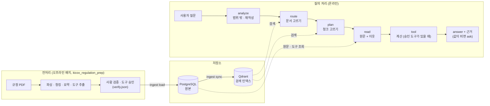
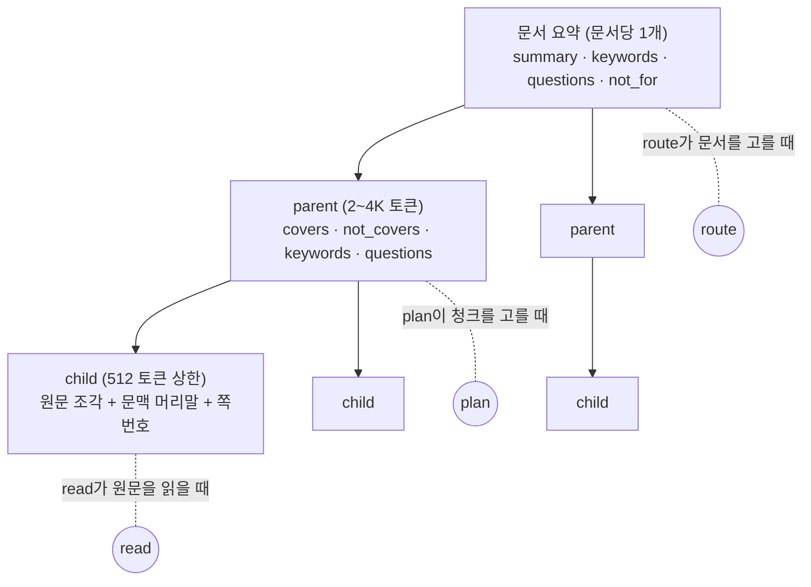
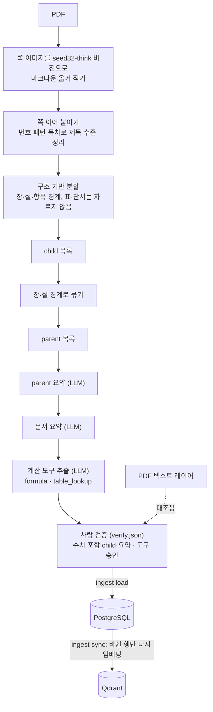
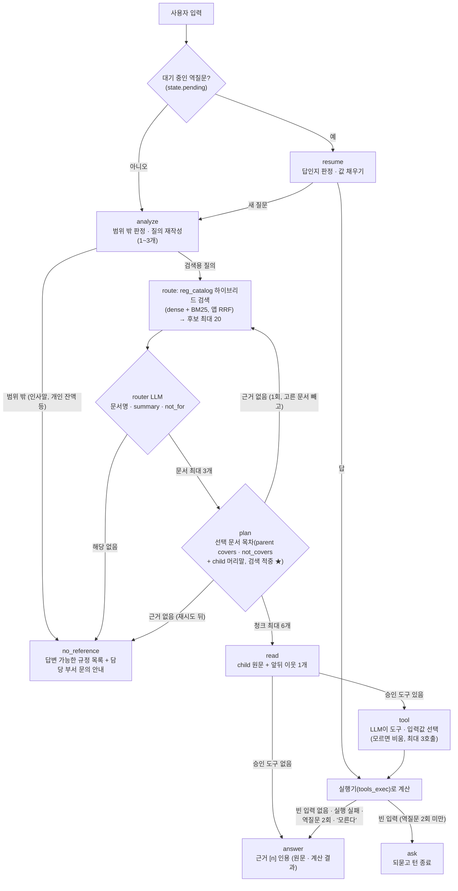
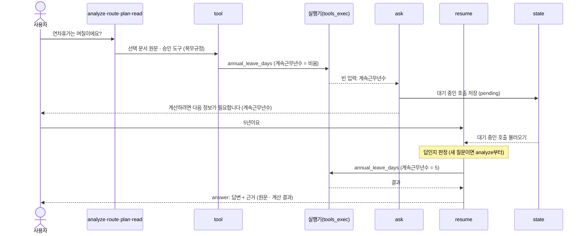
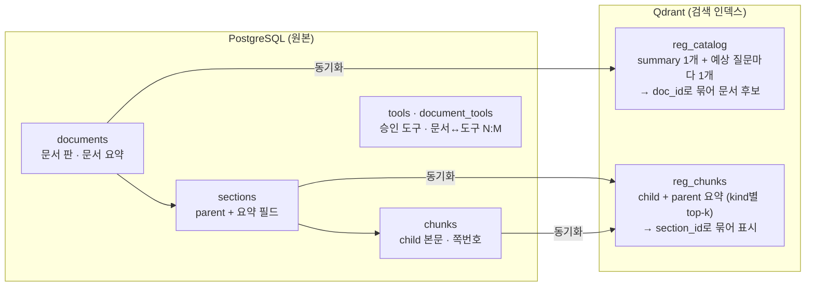

# RAG 챗봇 흐름 한눈에 보기

[RAG_DESIGN_NOTES.md](RAG_DESIGN_NOTES.md)의 설계 중 **지금 구현된 흐름**을 그림으로 간단히 정리한 문서입니다. 아직 구현하지 않은 설계(카테고리, 도구 바로 호출 등)는 "미구현"으로 표시합니다. 세부 근거와 수치는 각 그림 아래에 적은 원문 절을 봅니다.

- **기준일**: 2026-10-29
- **상태**: 구현 반영 (`backend/graph.py` 노드 9개: analyze · route · plan · read · tool · ask · resume · answer · no_reference)

---

## 1. 전체 구조

미리 해 두는 **전처리**(오프라인)와 사용자가 질문할 때 도는 **질의 처리**(온라인) 두 부분으로 나뉩니다.

---

## 2. 문서를 3계층으로 나누기

PDF 하나를 **문서 요약 → parent → child** 3계층으로 나누고, 계층마다 쓰는 곳이 다릅니다. (원문 §5.3)

| 계층 | 개수 | 요약 메타데이터 | 쓰는 곳 |
| :--- | :--- | :--- | :--- |
| 문서 요약 | 문서당 1개 | `summary`·`keywords`·`questions`·`not_for` | route (`reg_catalog` 컬렉션) |
| parent | 문서당 여러 개 | `covers`·`not_covers`·`keywords`·`questions` | plan (`reg_chunks` 컬렉션) |
| child | parent당 4~8개 | 없음 (문맥 머리말만 붙임) | 청크 검색, 원문 근거 |

- 요약 메타데이터는 청크마다가 아니라 **문서와 parent에만** 있습니다.
- `not_for`·`not_covers`는 "헷갈리기 쉽지만 여기가 아니라 저기"를 적는 필드입니다 (예: 시내출장 parent의 `not_covers`에 "4시간 이상·시외 일비 → 시외출장"). 검색에는 넣지 않고, 후보가 뽑힌 뒤 LLM이 고를 때만 보여 줍니다.
- 문서 요약은 본문이 32K에 들어가면(약 50쪽 이하) 본문 전체로 한 번에 만들고, 넘으면 parent 요약을 합쳐서 만듭니다.

---

## 3. 전처리 파이프라인

(원문 §5.3.3)

- 비전으로 옮겨 적은 이유: 여비 PDF는 본문 숫자가 텍스트 레이어에 없어서, 텍스트 추출·OCR로는 수치를 살리지 못했습니다(원문 §5.3.5).
- 도구는 승인된 것만 적재합니다(적재 조건은 [RDB_SPEC.md](RDB_SPEC.md) §3.4).

---

## 4. 질의 처리 흐름

(원문 §4, §5)

| 경로 | 예시 질문 | 흐름 | 근거 표시 |
| :--- | :--- | :--- | :--- |
| 원문 조회 | "복지포인트는 언제까지 써야 해요?" | analyze → route → plan → read → answer | 문서·청크·쪽 |
| 원문 확인 후 도구 | "연차휴가는 며칠이에요?" (복무규정 `annual_leave_days`) | … → read → tool → (ask) → answer | 원문 + 계산 근거 카드(입력값 · 계산 단계 · 근거 문구 · 쪽) |

- 원문을 먼저 읽고, 선택 문서에 승인 도구가 있으면 tool 노드가 계산이 필요한지 판단합니다. 도구는 계산(`formula` · `table_lookup`)만 있고 판정 도구는 없습니다.
- 도구 실행이 실패하면 계산 없이 원문으로만 답합니다. 역질문 2회 뒤나 사용자가 "모른다"고 하면 경우를 나눠 조건부로 답합니다.
- planner가 원문을 건너뛰고 도구를 바로 부르는 경로는 설계(원문 §4.1 단계 3)에만 있고 **미구현**입니다.
- 문서가 적은 지금은 planner에 선택 문서의 목차(parent 요약 + child 머리말 전체, 검색 적중 ★)를 통째로 줍니다(원문 §5.4-5).
- 질의 분석은 이전 턴 맥락을 반영해 검색용 질의를 다시 쓰고("해외는요?" → "해외 출장 일비"), 구어를 규정 용어로 바꾸고, 복합 질문은 나눕니다.
- 카테고리는 **추정만 하고 걸러내지 않는다**는 설계입니다(원문 §4.5). 분류안이 정해지기 전이라 지금은 카테고리를 추정하지 않습니다(**미구현**).
- 한도: 문서 최대 3 · 청크 최대 6 · route 재시도 1회 · 도구 호출 최대 3 · 역질문 최대 2회 (`backend/graph.py`).
- 화면용 SSE 이벤트 목록은 [README.md](../README.md) "SSE 이벤트"를 봅니다.

---

## 5. 역질문 멀티턴

역질문에 대한 답("5년이요")만 보고 다시 라우팅하면 다른 문서로 튈 수 있으므로, 다음 턴은 **저장된 state로 이어서** 처리합니다. (원문 §3-4, §3-5, §7)

- LLM은 사용자가 말한 값과 근거에서 바로 정해지는 값만 넣고 모르는 값은 비워 둡니다. 빈 입력을 찾아 역질문으로 넘기는 것은 코드(`_run_calls`)가 합니다. 값을 추측해 채우지 않습니다.
- 대기 중인 도구 호출과 입력값은 state(`tool_calls` · `tool_missing` · `asks` · `pending`)에 남고, 새 질문이 오면 비웁니다. 앞 턴에서 말한 값은 tool 노드가 최근 대화(6개)에서 다시 읽습니다.
- 대화 state는 지금 메모리(`InMemorySaver`)에 있어 서버를 다시 띄우면 대기 중인 역질문이 사라집니다.

---

## 6. 저장소 역할

(원문 §5.2, 구현 명세는 [RDB_SPEC.md](RDB_SPEC.md) · [VDB_SPEC.md](VDB_SPEC.md))

- PostgreSQL이 원본이고 Qdrant는 원본에서 다시 만들 수 있는 인덱스입니다. 사람의 검증 · 승인은 전처리 뷰어(`verify.json`)에서 하고 다시 적재합니다.
- 검색은 dense(`bge-m3-ko`)와 sparse(낱말 + 한글 2-gram, CRC32 BM25)를 앱에서 RRF(k=60)로 합칩니다. 리랭커는 아직 쓰지 않습니다.
