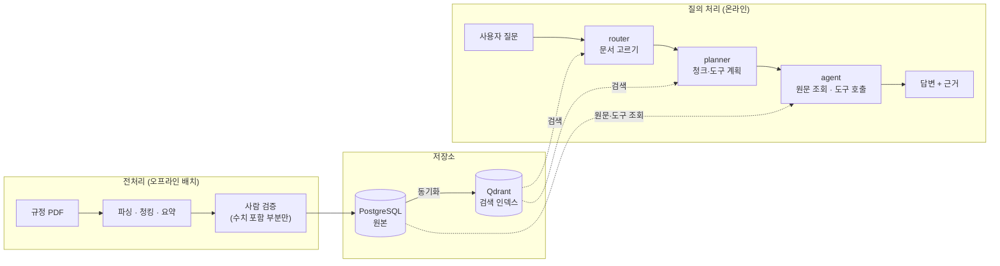
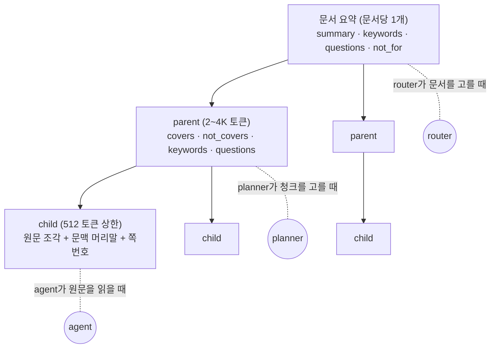
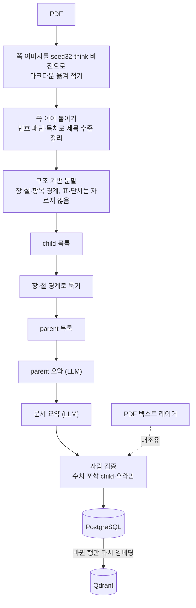
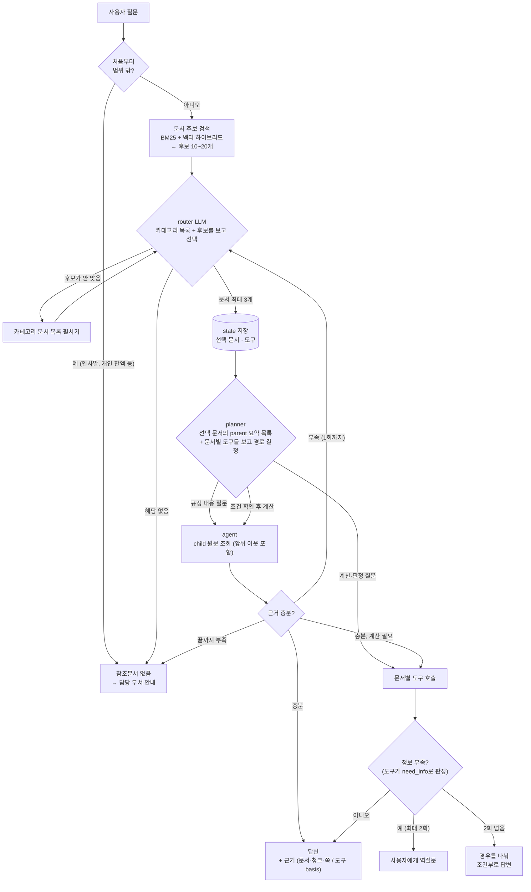
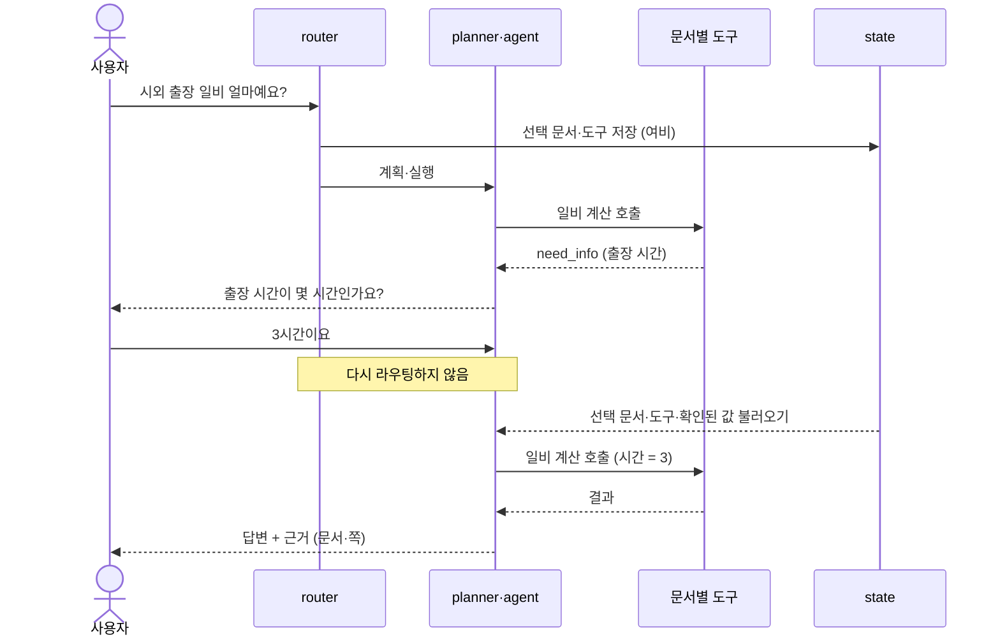
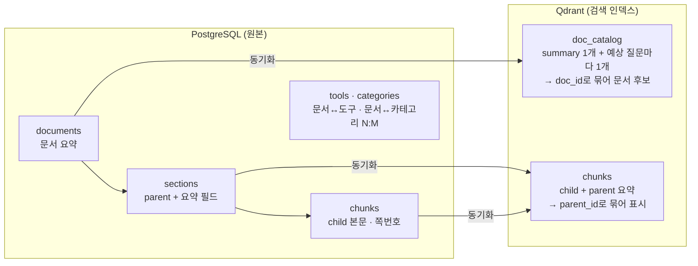

# RAG 챗봇 흐름 한눈에 보기

[RAG_DESIGN_NOTES.md](RAG_DESIGN_NOTES.md)에서 확정한 설계를 그림으로 간단히 정리한 문서입니다. 세부 근거와 수치는 각 그림 아래에 적은 원문 절을 봅니다.

- **기준일**: 2026-10-26
- **상태**: 설계 확정, 구현 전

---

## 1. 전체 구조

미리 해 두는 **전처리**(오프라인)와 사용자가 질문할 때 도는 **질의 처리**(온라인) 두 부분으로 나뉩니다.

---

## 2. 문서를 3계층으로 나누기

PDF 하나를 **문서 요약 → parent → child** 3계층으로 나누고, 계층마다 쓰는 곳이 다릅니다. (원문 §5.3)

| 계층 | 개수 | 요약 메타데이터 | 쓰는 곳 |
| :--- | :--- | :--- | :--- |
| 문서 요약 | 문서당 1개 | `summary`·`keywords`·`questions`·`not_for` | router (`doc_catalog` 컬렉션) |
| parent | 문서당 여러 개 | `covers`·`not_covers`·`keywords`·`questions` | planner (`chunks` 컬렉션) |
| child | parent당 4~8개 | 없음 (문맥 머리말만 붙임) | 청크 검색, 원문 근거 |

- 요약 메타데이터는 청크마다가 아니라 **문서와 parent에만** 있습니다.
- 문서 요약은 본문이 32K에 들어가면(약 50쪽 이하) 본문 전체로 한 번에 만들고, 넘으면 parent 요약을 합쳐서 만듭니다.

---

## 3. 전처리 파이프라인

(원문 §5.3.3)

- 비전으로 옮겨 적은 이유: 여비 PDF는 본문 숫자가 텍스트 레이어에 없어서, 텍스트 추출·OCR로는 수치를 살리지 못했습니다(원문 §5.3.5).

---

## 4. 질의 처리 흐름

(원문 §4, §5)

planner는 원문을 먼저 읽을지, 도구를 바로 부를지를 질문에 따라 정합니다.

| 경로 | 예시 질문 | 흐름 | 근거 표시 |
| :--- | :--- | :--- | :--- |
| 도구 바로 호출 | "시외 출장 3시간이면 일비 얼마예요?" | planner → 도구 | 도구 결과의 `basis` |
| 원문 조회 | "출장 증빙서류는 뭐가 필요해요?" | planner → child 원문 → 답변 | 문서·청크·쪽 |
| 원문 확인 후 도구 | "토익 학원비도 교육훈련비로 받을 수 있고, 학점은 몇 점이에요?" | planner → child 원문(대상 여부) → 도구(학점) | 둘 다 |

- 도구는 규정 수치를 이미 갖고 있으므로, 계산·판정 질문은 원문 조회를 거치지 않습니다. 원문 조회는 도구가 다루지 않는 내용(대상 여부, 예외, 절차)을 확인할 때만 합니다.
- 문서가 5종 미만인 지금 PoC 규모에서는 검색 없이 문서·청크 목차를 한 번에 주고 고르게 합니다(원문 §3-3).
- router는 planner와 분리된 별도 노드입니다.

---

## 5. 역질문 멀티턴

역질문에 대한 답("3시간이요")만 보고 다시 라우팅하면 다른 문서로 튈 수 있으므로, 다음 턴은 **저장된 state로 이어서** 처리합니다. (원문 §3-4, §3-5)

- 정보가 부족한지는 LLM이 아니라 **도구가 판정**합니다. LLM은 추측한 값으로 인자를 채우지 않습니다.
- 확인된 값은 state에 쌓고, 주제가 바뀌면 비웁니다.

---

## 6. 저장소 역할

(원문 §5.2)

- PostgreSQL이 원본이고, 사람은 여기서만 검증·수정합니다. Qdrant는 원본에서 다시 만들 수 있는 인덱스이며 동기화 작업만 씁니다.
- 검색은 dense(`dragonkue/bge-m3-ko`)와 sparse(Kiwi 형태소 + BM25)를 RRF로 합칩니다.
