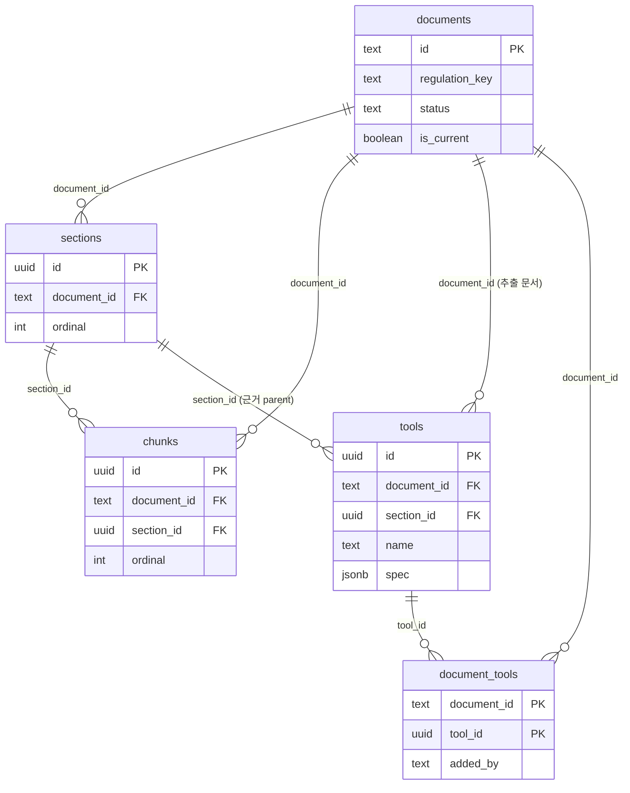
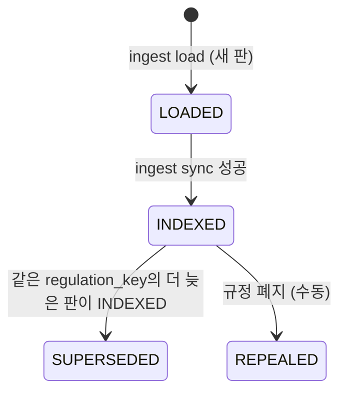

# RDB 스펙 (PostgreSQL)

본 문서는 `kicox_regulation_rag`가 쓰는 PostgreSQL 스키마의 **현재 구현 기준 명세**입니다. 왜 이렇게 정했는지(설계 근거 · 대안)는 [DB_LOADING_PLAN.md](DB_LOADING_PLAN.md)에 있고, 여기서는 테이블 · 열 · 제약 · 값 규칙 · 누가 언제 쓰고 읽는지만 정리합니다. Qdrant는 [VDB_SPEC.md](VDB_SPEC.md)를 봅니다.

- **기준일**: 2026-10-29
- **기준 코드**: `db/migrations/0001_init.sql`, `ingest/db.py` · `load.py` · `sync.py` · `ids.py` · `reader.py`, `backend/search.py`
- **역할**: 서비스 데이터의 원본. Qdrant는 이 DB만으로 다시 만들 수 있어야 합니다(DB_LOADING_PLAN §3 원칙 2)

---

## 1. 접속 · 마이그레이션

| 항목 | 값 |
| :--- | :--- |
| 서버 | 로컬 공용 컨테이너 `comwel-postgres-local` (PostgreSQL 18) |
| DB | `kicox`. 없으면 `migrate`가 같은 서버의 `postgres` DB로 접속해 만든다 |
| 접속 정보 | 환경변수 `KICOX_DATABASE_URL` (기본 `postgresql://localhost:5432/kicox`). `.env`에서 읽고 이미 설정된 환경변수가 우선 (`.env.example` 참고) |
| 드라이버 | `psycopg` 3 (동기). 백엔드는 `asyncio.to_thread`로 감싸 호출 |
| 마이그레이션 | `db/migrations/*.sql`을 파일 이름 순으로 한 번씩 적용. 파일 하나 = 트랜잭션 하나 |
| 적용 기록 | `schema_migrations` 테이블 (`ingest/db.py`가 만듦) |

```bash
uv run python -m ingest migrate
```

**`schema_migrations`**

| 열 | 형식 | NULL | 기본값 | 설명 |
| :--- | :--- | :---: | :--- | :--- |
| `version` | `text` PK | N | | 마이그레이션 파일 이름(확장자 제외). 예: `0001_init` |
| `applied_at` | `timestamptz` | N | `now()` | 적용 시각 |

---

## 2. 관계



- 용어: **문서 판** = PDF 하나(`documents` 행 하나), **parent** = `sections` 행, **child** = `chunks` 행.
- 모든 FK는 `ON DELETE CASCADE`입니다. 문서 판 행을 지우면 그 판의 절 · 청크 · 도구 · 노출 연결이 함께 지워집니다.
- 테이블은 이 5개(+ `schema_migrations`)뿐입니다. 쪽 · 검증 · 카테고리 · 색인 장부 테이블을 두지 않는 이유는 DB_LOADING_PLAN §4.3.

---

## 3. 테이블

### 3.1 `documents` — 문서 판

| 열 | 형식 | NULL | 기본값 | 제약 · 값 규칙 | 원천 (전처리 산출물) |
| :--- | :--- | :---: | :--- | :--- | :--- |
| `id` | `text` PK | N | | `doc_id` = 원본 PDF SHA-256 앞 12자 (16진수). 개정판은 다른 값 | `meta.doc_id` |
| `regulation_key` | `text` | N | | 같은 규정의 판을 묶는 키. `alio:{idx}`, ALIO 정보가 없으면 `manual:{doc_id}` | `meta.rule.idx` |
| `name` | `text` | N | | 문서명 | `meta.name` |
| `amended_on` | `date` | Y | | ALIO 제개정일. ALIO 정보가 없으면 NULL | `meta.rule.제개정일` |
| `status` | `text` | N | `'LOADED'` | `CHECK IN ('LOADED','INDEXED','SUPERSEDED','REPEALED')` (§4) | — |
| `is_current` | `boolean` | N | `false` | 규정마다 현행 판 하나. 부분 유니크 인덱스 `documents_current_uq` | — |
| `summary` | `text` | N | | 문서 요약. 관문에서 빈 값이면 적재하지 않음 | `summaries.doc.fields.summary` |
| `not_for` | `text` | Y | | 이 문서가 다루지 않는 것. 빈 문자열은 NULL로 저장 | `summaries.doc.fields.not_for` |
| `keywords` | `text[]` | N | `'{}'` | 문서 키워드 | `summaries.doc.fields.keywords` |
| `questions` | `text[]` | N | `'{}'` | 예상 질문. 배열 순서가 catalog 포인트 ID(`doc_question:{i}`)에 들어가므로 의미가 있음 | `summaries.doc.fields.questions` |
| `content_hash` | `text` | N | | 산출물 묶음 해시 (16진수 16자, §5). 같으면 적재를 건너뜀 | 파일 바이트에서 계산 |
| `indexed_hash` | `text` | Y | | catalog 포인트 묶음(요약 1 + 질문 N)을 마지막으로 색인한 입력 해시. 색인 전 · 이전 판은 NULL | — |

인덱스

| 이름 | 정의 |
| :--- | :--- |
| `documents_pkey` | `(id)` |
| `documents_current_uq` | `UNIQUE (regulation_key) WHERE is_current` |

### 3.2 `sections` — parent (절)

| 열 | 형식 | NULL | 기본값 | 제약 · 값 규칙 | 원천 |
| :--- | :--- | :---: | :--- | :--- | :--- |
| `id` | `uuid` PK | N | | `uuid5(NS, "{doc_id}:parent:{hash}:{n}")` (§5) | — |
| `document_id` | `text` FK → `documents.id` | N | | | |
| `ordinal` | `int` | N | | 문서 안 순서. 0부터. 적재 때마다 새로 씀 | `chunks.parents` 배열 순서 |
| `title` | `text` | N | | 절 제목 | `parents[].title` |
| `page_start`, `page_end` | `int` | Y | | 쪽 범위 (1부터) | `parents[].page_start` · `page_end` |
| `covers` | `text` | Y | | 이 절이 다루는 것. 요약이 없거나 stale이면 NULL (searchable parent는 관문에서 걸러지므로 사실상 non-searchable만 NULL) | `summaries.parents[id].fields.covers` |
| `not_covers` | `text` | Y | | 이 절이 다루지 않는 것. 위와 같은 조건으로 NULL | `…fields.not_covers` |
| `keywords` | `text[]` | N | `'{}'` | | `…fields.keywords` |
| `questions` | `text[]` | N | `'{}'` | | `…fields.questions` |
| `searchable` | `boolean` | N | | false면 색인하지 않음 (목차만 있는 parent) | `parents[].searchable` |
| `content_hash` | `text` | N | | parent `hash` = child 본문을 이은 텍스트 SHA-256 앞 16자 | `parents[].hash` |
| `indexed_hash` | `text` | Y | | `parent_summary` 포인트 입력 해시. 색인 대상이 아니면 NULL | — |

인덱스: `sections_pkey (id)`, `sections_document_idx (document_id, ordinal)`

### 3.3 `chunks` — child (청크)

| 열 | 형식 | NULL | 기본값 | 제약 · 값 규칙 | 원천 |
| :--- | :--- | :---: | :--- | :--- | :--- |
| `id` | `uuid` PK | N | | `uuid5(NS, "{doc_id}:child:{hash}:{n}")`. Qdrant child 포인트 ID와 같음 | — |
| `document_id` | `text` FK → `documents.id` | N | | | |
| `section_id` | `uuid` FK → `sections.id` | N | | 소속 parent | `children[].parent_id` → 매핑 |
| `ordinal` | `int` | N | | 문서 안 순서. 0부터. 앞뒤 이웃 조회 기준 | `chunks.children` 배열 순서 |
| `header` | `text` | N | | 문맥 머리말 `문서명 > 장 > 조` (원본 그대로, 중복 축약 전) | `children[].header` |
| `body` | `text` | N | | child 원문 | `children[].text` |
| `tokens` | `int` | N | | 본문 토큰 수 (seed32-think 토크나이저 기준) | `children[].tokens` |
| `page_start`, `page_end` | `int` | Y | | 쪽 범위 | `children[].page_start` · `page_end` |
| `searchable` | `boolean` | N | | false면 색인하지 않음 (목차 쪽 child) | `children[].searchable` |
| `has_numbers` | `boolean` | N | | 수치가 든 child | `children[].has_numbers` |
| `verified` | `boolean` | N | `false` | 사람 검증 표시. `verify.json["{child hash}"].verified` | `verify.json` |
| `content_hash` | `text` | N | | child `hash` = `header + "\n" + text`의 SHA-256 앞 16자 | `children[].hash` |
| `indexed_hash` | `text` | Y | | `child` 포인트 입력 해시 | — |

인덱스: `chunks_pkey (id)`, `chunks_document_idx (document_id, ordinal)`, `chunks_section_idx (section_id)`

### 3.4 `tools` — 승인된 계산 도구

| 열 | 형식 | NULL | 기본값 | 제약 · 값 규칙 | 원천 |
| :--- | :--- | :---: | :--- | :--- | :--- |
| `id` | `uuid` PK | N | | `uuid5(NS, "{doc_id}:tool:{spec_hash}")` | `tools[].spec_hash` |
| `document_id` | `text` FK → `documents.id` | N | | 도구를 추출한 문서 판 | |
| `section_id` | `uuid` FK → `sections.id` | N | | 근거 parent | `tools[].parent_id` → 매핑 |
| `name` | `text` | N | | `spec.name`. `UNIQUE (document_id, name)` | `tools[].spec.name` |
| `spec` | `jsonb` | N | | 도구 정의 전체 (종류 `kind` · 설명 · 입력 · 단위 · `steps` 등). 형식은 [MCP_TOOL_DESIGN.md](MCP_TOOL_DESIGN.md) | `tools[].spec` |

인덱스: `tools_pkey (id)`, `tools_document_id_name_key UNIQUE (document_id, name)`

**적재 조건** (`ingest/gate.py` `approved_tools`): 아래를 모두 만족하는 도구만 행이 됩니다.

1. `parent_hash`가 현재 parent `hash`와 같음 (stale 아님)
2. `checks.status != 'error'`
3. `verify.json["tool:{spec_hash}"].verified == true`
4. 식 도구가 `lookup("표", …)`로 부르는 표 도구(`kind = 'table_lookup'`)가 모두 1~3을 통과함

### 3.5 `document_tools` — 문서별 노출 도구 (N:M)

| 열 | 형식 | NULL | 기본값 | 제약 · 값 규칙 |
| :--- | :--- | :---: | :--- | :--- |
| `document_id` | `text` FK → `documents.id` | N | | PK 일부. 이 문서 질문에 노출할 도구 |
| `tool_id` | `uuid` FK → `tools.id` | N | | PK 일부 |
| `added_by` | `text` | N | `'ingest'` | `CHECK IN ('ingest','manual')`. 로더가 넣은 행은 `ingest`, 다른 문서의 도구를 사람이 이은 행은 `manual` |

인덱스: `document_tools_pkey (document_id, tool_id)`

- 로더는 도구를 적재할 때 추출 문서와 `added_by='ingest'`로 잇고(`ON CONFLICT DO NOTHING`), 직접 지우지는 않습니다.
- 도구의 승인이 풀려 `tools` 행이 지워지면 그 도구를 가리키는 연결은 `manual` 행까지 CASCADE로 지워집니다.

---

## 4. 문서 판 상태



| 상태 | 의미 | 검색 대상 | Qdrant 포인트 | `indexed_hash` |
| :--- | :--- | :---: | :--- | :--- |
| `LOADED` | PostgreSQL에 들어감. 색인 전이거나 색인 실패 | X | 일부 있을 수 있음 | 일부 채워짐 |
| `INDEXED` | 색인 완료 | `is_current`일 때만 O | 있음 | searchable 행 모두 채워짐 |
| `SUPERSEDED` | 새 판으로 바뀜 | X | 없음 (전환 때 삭제) | NULL로 비움 |
| `REPEALED` | 규정 폐지 | X | 없어야 함 | — |

- **현행 판 규칙** (`sync.switch_current`): 같은 `regulation_key`의 `INDEXED` 판 중 `amended_on`이 가장 늦은 판(NULL은 가장 뒤, 같으면 기존 현행 우선)이 `is_current = true`, 나머지 `INDEXED` 판은 `SUPERSEDED`.
- 이전 판 행은 지우지 않습니다(이전 답변의 근거 링크용). 다시 살리면 `indexed_hash`가 비어 있어 전량 색인됩니다.
- `REPEALED`로 바꾸는 코드는 아직 없습니다. 폐지는 SQL로 `status='REPEALED', is_current=false`를 쓰고 Qdrant 포인트를 지워야 합니다(폐지 판정은 DB_LOADING_PLAN §11-6에서 미정).

---

## 5. 해시 · ID 규칙

| 값 | 계산 | 길이 |
| :--- | :--- | :--- |
| `documents.id` | 원본 PDF SHA-256 앞 12자 (전처리가 정함) | 12 |
| `documents.content_hash` | `sha256("load:{LOAD_VERSION}" + Σ "\0{파일명}\0" + 파일 바이트)`, 파일은 `meta` · `chunks` · `summaries` · `tools` · `verify`.json 순 (없는 파일은 빈 바이트) | 16 |
| `sections.content_hash` | 전처리 parent `hash` | 16 |
| `chunks.content_hash` | 전처리 child `hash` = `sha256(header + "\n" + text)` | 16 |
| `*.indexed_hash` | Qdrant 포인트 입력 해시 ([VDB_SPEC.md](VDB_SPEC.md) §6) | 16 |
| `sections.id` · `chunks.id` | `uuid5(NS, "{doc_id}:{parent\|child}:{hash}:{n}")`. `n`은 같은 문서 안에서 같은 해시가 반복될 때만 1, 2 … (보통 0) | uuid |
| `tools.id` | `uuid5(NS, "{doc_id}:tool:{spec_hash}")` | uuid |

- `NS = c21cf703-e657-41f2-ba2d-ed2b8e117b72` (`ingest/config.py`). 바꾸면 모든 ID가 바뀝니다.
- `LOAD_VERSION`(현재 1)은 로더가 행을 만드는 방식이 바뀌면 올립니다. 올리면 같은 산출물도 다시 적재됩니다.
- ID가 내용 해시에서 나오므로 **재청킹해도 내용이 같은 parent · child는 ID가 유지**되고, 바뀐 것만 새 ID가 됩니다.

---

## 6. 쓰기 (적재 · 동기화)

### 6.1 `ingest load` — 문서 판 1건 = 트랜잭션 1개 (`ingest/load.py`)

1. `SELECT content_hash FROM documents WHERE id = ? FOR UPDATE` → 같으면 건너뜀(`skipped`).
2. upsert. 충돌 시 갱신하는 열과 그대로 두는 열은 아래와 같습니다.

| 테이블 | `ON CONFLICT (id)`에서 갱신 | 그대로 둠 |
| :--- | :--- | :--- |
| `documents` | `regulation_key` · `name` · `amended_on` · `summary` · `not_for` · `keywords` · `questions` · `content_hash` | `status` · `is_current` · `indexed_hash` |
| `sections` | `ordinal` · `title` · 쪽 · `covers` · `not_covers` · `keywords` · `questions` · `searchable` | `content_hash`(ID에 포함) · `indexed_hash` |
| `chunks` | `section_id` · `ordinal` · `tokens` · 쪽 · `searchable` · `has_numbers` · `verified` | `header` · `body` · `content_hash`(ID에 포함) · `indexed_hash` |
| `tools` | `section_id` | `name` · `spec`(ID에 포함) |

3. 이번 입력에 없는 행 삭제: `chunks` → `tools`(승인이 풀린 것, 같은 이름의 새 spec이 UNIQUE에 걸리지 않도록 먼저) → `sections`.
4. 행 수 확인: `sections` · `chunks` · `tools` 행 수가 산출물의 parent · child · 승인 도구 수와 다르면 예외로 롤백.
5. 트랜잭션 밖에서 `source.pdf` · `pages/*.png`를 `storage/docs/{doc_id}/`로 복사 (DB에는 경로를 적지 않음).

관문(`gate.check`)에 걸린 판은 행을 만들지 않습니다. 사유는 DB_LOADING_PLAN §7.1.

### 6.2 `ingest sync` — PostgreSQL → Qdrant (`ingest/sync.py`)

| 단계 | PostgreSQL 쓰기 |
| :--- | :--- |
| 바뀐 포인트 upsert (64개 배치마다 커밋) | `sections` · `chunks`의 `indexed_hash` 갱신 |
| catalog 포인트를 모두 넣은 뒤 | `documents.indexed_hash` 갱신 |
| 문서 판 동기화 성공 | `status = 'INDEXED' WHERE status = 'LOADED'` |
| 현행 판 전환 (트랜잭션 1개) | 새 현행 `is_current = true`, 나머지 `INDEXED` → `SUPERSEDED` · `is_current = false`, 그 판들의 `documents` · `sections` · `chunks.indexed_hash = NULL` |

대상은 `status IN ('LOADED','INDEXED')`인 판입니다. 실패하면 `indexed_hash`가 갱신되지 않은 행만 남고, 다음 실행이 그 행부터 이어서 합니다.

### 6.3 사람이 직접 쓰는 것

| 대상 | 방법 |
| :--- | :--- |
| `document_tools` 다른 문서 도구 연결 | `INSERT … added_by = 'manual'` |
| 규정 폐지 | `UPDATE documents SET status='REPEALED', is_current=false` + Qdrant 포인트 삭제 (§4) |

그 밖의 열은 로더만 씁니다. 검증 · 도구 승인은 전처리 뷰어(`verify.json`)에서 하고 다시 적재합니다.

---

## 7. 읽기 (질의 처리)

`backend/search.py`가 쓰는 쿼리입니다. Qdrant 결과는 그대로 믿지 않고 **항상 `is_current`를 PostgreSQL에서 다시 확인**합니다.

| 함수 | 쓰는 곳 | 읽는 열 | 조건 |
| :--- | :--- | :--- | :--- |
| `_search_docs` | router 문서 후보 표시 | `documents.id` · `name` · `summary` · `not_for` | `id = ANY(후보) AND status = 'INDEXED' AND is_current` |
| `_list_sections` | planner 절 목록 | `sections.*`(id · ordinal · title · covers · not_covers · 쪽) + `documents.name` + 소속 searchable `chunks.id` 배열 | `document_id = ANY(선택 문서) AND d.is_current`, 선택 문서 순서 → `ordinal` 순 |
| `_get_chunks` | agent 원문 조회 | `chunks.header` · `body` · 쪽 · `has_numbers` · `verified` + `documents.name` + `sections.title` | 요청 child와 같은 문서에서 `|ordinal 차| ≤ neighbors`(기본 1), `d.is_current` |
| `_documents` | 화면 상단 문서 목록 | `documents.id` · `name` · `amended_on` + 청크 수 | `is_current AND status = 'INDEXED'` |

- 답변의 "검증 전 수치" 표시는 `chunks.has_numbers AND NOT chunks.verified`로 판단합니다.
- `tools` · `document_tools`는 아직 질의 처리에서 읽지 않습니다(승인된 도구가 0개라 도구 경로 보류, RAG_DESIGN_NOTES 변경 이력 2026-10-28).
- `sections.keywords` · `questions`, `documents.keywords` · `questions`는 질의 처리에서 읽지 않고 Qdrant 재색인 입력으로만 씁니다.

---

## 8. 정합성 점검

`uv run python -m ingest check` (sync 끝에도 실행)가 확인하는 불변식입니다.

| 불변식 | 확인 방법 |
| :--- | :--- |
| 산출물 개수 = 행 수 | 적재 트랜잭션 안에서 (§6.1-4) |
| `INDEXED` 판의 searchable 행은 `indexed_hash`가 있음 | `chunks` searchable, `sections` searchable · `covers IS NOT NULL` 중 `indexed_hash IS NULL` 0개 |
| `INDEXED` 판이 있는 규정마다 현행 판 1개 | `GROUP BY regulation_key HAVING count(*) FILTER (WHERE is_current) <> 1` 0건 |
| PostgreSQL에서 계산한 포인트 수 = Qdrant 포인트 수 | [VDB_SPEC.md](VDB_SPEC.md) §8 |

---

## 9. 현재 규모 (로컬, 2026-10-28)

| 문서 | `id` | sections | chunks | tools |
| :--- | :--- | :---: | :---: | :---: |
| 맞춤형복리후생제도 운영지침 | `46e9cf81e6af` | 8 | 25 | 0 |
| 보수규정 시행세칙 | `e1f17de5627c` | 8 | 98 | 0 |

ALIO 138건을 적재하면 다시 셉니다(DB_LOADING_PLAN §10 6단계).

---

## 10. 변경 이력

| 날짜 | 내용 |
| :--- | :--- |
| 2026-10-29 | 최초 작성: `0001_init` 스키마와 `ingest/` · `backend/search.py` 구현 기준으로 테이블 · 제약 · 값 규칙 · 상태 · 쓰기 · 읽기 · 점검 정리 |
